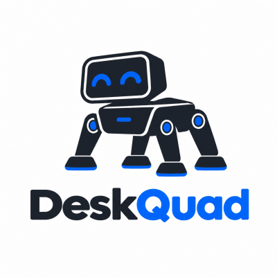

  

   
   
   

DeskQuad 是一款基于 ESP32-S3 构建的桌面四足机器人，集成表情显示、舵机动作、手势识别与 AI 对话。
固件负责运动、情感与交互，设备端 Web 控制台随固件一同打包进 LittleFS，开机即可通过浏览器遥控与配置。

## 功能

- 四足舵机动作与表情动画，支持遥控、随机自由模式与 AI 驱动的情绪表达
- OLED 表情、电量与时间天气展示，按键交互
- 摄像头手势识别，多模态情感融合
- 内置 Web 控制台（Vue 3），设备开热点即可访问，无需额外安装 App

## 快速开始

构建、烧录与访问方式见 [firmware/README.md](./firmware/README.md)。

## License

[MIT](./LICENSE)
